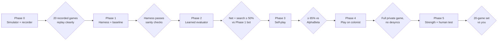
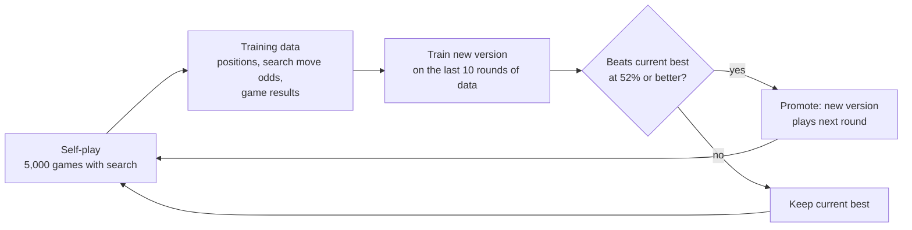

# Colonist 1v1 AI: Implementation Plan (v2)

Oct 3, 2026 · @OwenChen07

Build a self-play AI for colonist's 1v1 rules, starting from the open-source Catanatron
simulator, and connect it to colonist so it can play there in private games. The first target
is to beat Catanatron's best bot in more than 55% of games under colonist's rules.

## Goal

The goal is an AI that beats the existing Catan bots at colonist's 1v1 rules, plays on
colonist itself, and is then tested against you (Gold rank). No published AI beats strong
human players yet, but Gold is a mid-ladder level, so beating you is a fair stretch target
rather than a long shot.

Every strength claim against a bot is measured the same way: paired boards (each board played
twice with seats swapped), 1,000 games, which gives a win rate accurate to about 3 points
either way at 95% confidence.

- **First gate:** wins at least 55% against Catanatron's best bot, AlphaBeta.
- **Target:** wins at least 65% against it.
- **Stretch:** wins at least 13 of 20 games against you on colonist. A bot only as strong as
  you would do that about 1 time in 8, so 20 games is a demonstration, not a measurement.

**Where it plays.** The local simulator, and private colonist rooms where the opponent has
been told they are playing a bot. Never ranked or public games: the bridge checks the room
type and refuses to make moves anywhere else (see Phase 4). Colonist's terms of service may
forbid automation even in private rooms, so using the bridge risks the account it runs on.
Check the terms before Phase 4, and run the bot on a separate account from your ranked one.

## Roadmap

## Phases

Each phase ends at a gate, and the next phase starts once the gate is passed.

### Phase 0: a simulator that plays by colonist's rules, and a game recorder

- Fork Catanatron and turn on 15 points, the 9-card hand limit and the friendly robber.
- Fix the friendly robber to count **visible** points only. Today it counts hidden victory
  point cards too, which also leaks those hidden cards through the legal-move list.
- Add colonist's balanced dice, ported from the tracker extension's `src/dice.js` (rules
  table below). Keep the dice switchable between balanced and plain random.
- Let the simulator take forced chance outcomes (dice, steals, development card draws). The
  replay check needs this, and so do the search's chance nodes in Phase 2.
- Build the **game recorder**: a browser extension in this repo that reads the board
  (hexes, numbers, ports) and the game log from colonist and exports a game record. The
  tracker only reads the log, and a replay also needs the board. The recorder is the
  read-only half of the Phase 4 bridge, and it reuses the tracker's log parser.
- Check the remaining rule details against real colonist games (see the rules table).
- **Gate:** 20 of your recorded 1v1 games replay through the simulator with no illegal move
  and matching card counts.

### Phase 1: a measuring stick and a baseline bot

- Build the evaluation harness: paired boards, swapped seats, win rate with its margin of
  error, plus an early-stopping sequential test (SPRT) for promotion matches.
- Set up a ladder of reference bots: Random, WeightedRandom, ValueFunction, AlphaBeta.
- Run a sustained one-hour benchmark to measure how much the fanless Air slows down under
  load, and use that number in all later time estimates.
- Retune AlphaBeta's hand-written scoring for 15-point 1v1 by automatic tuning (SPSA over
  paired seeds, at reduced search depth to keep it fast).
- **Gate:** the harness passes three checks. Two identical bots score 50% ± 3. The ladder
  comes out in the expected order. A rerun with the same seeds gives identical results.
- **Soft target, not blocking:** the retuned bot wins at least 55% against stock AlphaBeta.
  Phase 2 just needs a decent bot to record games from.

### Phase 2: a learned evaluator

- Record about 40,000 games from the best baseline bot, keeping about 40 positions per game
  (about 1.6 million positions). Spreading the same number of positions over many more
  games, instead of 1.5 million positions from about 4,700 games, keeps the value net from
  overfitting a few thousand outcomes.
- Train a neural network to predict who wins from a position and which move the baseline
  bot chose.
- Build the search (see Design choices) and use the network inside it in place of the
  hand-written scoring.
- Benchmark one full self-play game with the real search and network. If it takes more than
  5 seconds per performance core, speed up the slowest part (most likely input building)
  before Phase 3, and rewrite the inner loop in Rust if that isn't enough.
- **Gate:** network plus search wins at least 50% (point estimate) against the Phase 1 bot
  at equal thinking time. This gate checks that the learned evaluator is no worse than the
  hand-written one, not that it is better.

### Phase 3: self-play

- Run the self-play loop (see How it learns).
- A new version is promoted when it beats the current best at **52% or better**. The test
  is an SPRT of 50% against 54% (midpoint 52%) with 5% error rates, capped at 2,000 games,
  so clear results stop early.
- **Gate:** wins at least 65% against AlphaBeta.

### Phase 4: play on colonist

- Extend the Phase 0 recorder into a two-way bridge. Turn the colonist board and log into a
  simulator position, ask the AI for a move, and play the move by clicking colonist's own
  controls. The bridge never builds or sends game messages itself.
- Safety rails in code: act only in private rooms, post a message in the game chat at the
  start saying the player is a bot, and stop if the simulator position stops matching
  colonist's (card counts, buildings, dice).
- Handle colonist's turn timer: give the search a time budget per move, and play the
  network's top move if time is short.
- **Gate:** one full private game against you on colonist, with no manual help and no loss
  of sync.

### Phase 5: strength and the human test

- Longer training runs, a larger network and deeper search at play time.
- **Gate:** a 20-game set against you on colonist, in private rooms.

## How it learns

One round is one trip around the loop, and Phase 3 repeats it until its gate is reached. The
search inside every self-play move finds better moves than the network alone would pick.
Training on those moves is what makes the next version stronger.

Starting values for one round, to be adjusted as we go:

| Setting | Value |
|---|---|
| Self-play games per round | 5,000 (about 1 hour) |
| Opponents | 80% latest version, 20% older versions and reference bots |
| Data kept | Last 10 rounds (about 50,000 games) |
| Value target | Average of the game result and the search's value at that position |
| Promotion match | SPRT 50% vs 54%, at most 2,000 games, 100 simulations per move |

## Colonist's 1v1 rules

Catanatron already supports most of colonist's 1v1 rules as options. The balanced dice and
the friendly-robber fix are the real work. I checked this in Catanatron's code (latest commit
8 Sep 2026). The colonist column comes from colonist's 1v1 guide (2023) and the tracker
extension, so Phase 0 rechecks it against real games.

| Rule | Colonist 1v1 | Catanatron today | Work needed |
|---|---|---|---|
| Points to win | 15 | Option, default 10 | Set to 15 |
| Hand limit on a 7 | Hold up to 9 cards | Option, default 7 | Set to 9 |
| Discards | Player chooses which cards | Player chooses, one card at a time | None |
| Friendly robber | A player with 2 or fewer visible points can't be blocked or robbed | Option exists, but counts hidden victory point cards | Small fix: count visible points only |
| Dice | Balanced deck (below) | Two plain random dice | Port from the tracker |
| Trading with the opponent | None | Built-in bots never offer trades | None |
| Development cards | One per turn, before or after rolling, not on the turn bought | Same | None |
| Board | Standard 19-hex board | Supported | None |
| Number layout | Not confirmed | Official spiral or fully random | Confirm from real games |

**Balanced dice**, as the tracker models them (`colonist-tracker/src/dice.js`):

- A deck of 36 cards, one per pair of dice faces. A drawn card is removed, and all 36 go back
  in before a draw if fewer than 13 are left.
- A total's base weight is the number of cards with that total left, divided by cards left.
- Recency: the weight drops by 34% for each time that total came up in the last 5 rolls, down
  to a floor of zero.
- 7s depend on who rolls: their share of all 7s so far, plus 0.4 times the length of the
  current run of 7s by one player (lower if it's their own run, higher if it's the other
  player's), with the multiplier kept between 0 and 2.

## Design choices

The AI is a neural network that judges positions, paired with a search that looks ahead.
This is the AlphaZero recipe, adapted for dice.

- **What the network sees.** Catanatron describes a 2-player position as 614 numbers: the
  board, both players' buildings, hands, and played and unplayed card counts. The opponent's
  unplayed development cards appear only as a count, so nothing hidden leaks in (checked in
  `features.py`). To that I add the dice state: cards left for each total, the last 5 totals,
  each player's count of 7s, and the current 7-streak (whose run it is, and its length).
- **Moves.** A 2-player game has 332 possible moves in total. At each decision the network
  only chooses among the legal ones. Forced moves, such as rolling when nothing else is
  possible, skip the search.
- **Search.** A Monte Carlo tree search guided by the network, with Gumbel root selection.
  Gumbel selection is built to improve on the network's choice even with very few
  simulations. It starts at 50 simulations per move in training and 400 or more when playing
  for real.
- **Chance.** Dice rolls, development card draws and robber steals are chance events inside
  the search, each with its true odds. Dice odds come from the balanced-dice rules, so the AI
  plans around the real deck.
- **Hidden cards.** In 1v1 the opponent's resource hand can be worked out from the log. Only
  their unplayed development cards are hidden, so the search samples those from the cards not
  yet seen. Fixing a sample for each search can make the AI act as if it knows the hidden
  cards. With only development cards hidden this should be minor, and the fallback is to
  re-sample at every chance node.
- **Network size.** Start with a small fully connected network of about 1 million
  parameters. Move to a board-aware network of the kind Gendre and Kaneko used if progress
  stalls. Train on the Air's GPU (PyTorch MPS). Run self-play inference in batches across
  parallel games, because per-call framework overhead is larger than the network itself at
  this size.
- **Reproducibility.** Every game has a seed and every saved version is scored by the Phase
  1 harness.

## Time and compute

All phases run on your MacBook Air (M4: 4 performance and 6 efficiency cores, 16 GB, no
fan). A rented machine can be added later if Phase 3 is too slow.

Measured on this Air on 3 Oct 2026 with colonist's 1v1 settings, one core
(`bench/speed.py`):

| Measurement | Result |
|---|---|
| Two random bots | 50 games per second |
| ValueFunction against itself | 2.4 games per second; about 103 turns and 355 decisions per game |
| AlphaBeta against ValueFunction | 1.7 seconds per game |
| One search step (copy the position, play one move) | 21 microseconds |
| Building the 614 network inputs | 58 microseconds |
| A 1.3M-parameter network, one position at a time | 26 microseconds |
| The same network, 64 positions at a time | 5 microseconds per position |

These numbers are about 4 times faster than the earlier 2-core cloud measurements (96
microseconds per step). Building the inputs, not the network, is now the largest measured
cost per simulation. Faster input building is the first optimization to try.

**Self-play estimate.** One simulation costs about 21 µs (step) + 58 µs (inputs) + 5–26 µs
(network) + an estimated 30–50 µs of search bookkeeping, about 130 µs in total. A game
searches about 250 decisions at 50 simulations each, plus about 30% more for chance nodes.
That comes to about 2–2.5 seconds per game per performance core. The 6 efficiency cores add
about 2.5 performance cores' worth. After a 20% allowance for throttling, that is about 2
games per second, so 100,000 games take about 14 hours. The search bookkeeping is a guess
until Phase 2's benchmark, and the throttling allowance is a guess until Phase 1's sustained
run.

**Evaluation at play strength.** At 400 simulations a game takes about 15–20 seconds per
core, so a 1,000-game match takes about an hour.

| Phase | Build time | Machine time |
|---|---|---|
| 0: simulator + recorder | About 1 week | Minutes |
| 1: harness + baseline | 2 to 3 days | One sustained benchmark, one overnight tuning run |
| 2: learned evaluator | About a week | Overnight to record 40,000 games, a few hours to train |
| 3: self-play | 1 to 2 weeks | Several runs of 1 to 2 days each |
| 4: play on colonist | 1 to 2 weeks | None |
| 5: strength | Open-ended | Open-ended |

Phase 3 runs tie up the laptop: keep it plugged in, and expect it to run warm and be slow for
other work.

## Risks

The biggest risk is that self-play stalls at the level of the hand-written bots, which is
what happened in most published Catan projects.

| Risk | How we would notice | Fallback |
|---|---|---|
| Self-play stalls at bot level | No new version is promoted for 5 rounds | More search per move, a wider opponent pool, then the board-aware network |
| Simulator rules differ from colonist's | The Phase 0 replay check fails | Fix the rule before any training starts |
| The Python simulator is too slow | The Phase 2 benchmark is above 5 seconds per game per performance core | Faster input building first, then rewrite the inner loop in Rust (another project measured 88 nanoseconds per step) |
| The Air throttles more than expected | The Phase 1 sustained benchmark | Fewer workers, shorter runs, or rent a machine for Phase 3 |
| Noisy results mislead us | Win rates move by less than the 3-point margin | Raise close comparisons from 1,000 to 4,000 games; promotion already uses SPRT |
| Live dice differ from the code we have | The tracker flags Random dice in your games | Keep the dice switchable and train on both kinds |
| Colonist changes its page | The bridge or recorder loses sync | It stops instead of guessing; fix the reader |
| Colonist objects to the bot | Terms of service, or action against the account | Private rooms only, separate account; stop if asked |
| Licence | Publishing the code | Catanatron is GPL-3, so this repo is GPL-3. The dice are written from the rules, without copying colonist's code |

## Decisions made

| Question | Decision |
|---|---|
| Compute | The MacBook Air M4 for now. Revisit renting a machine if Phase 3 is too slow |
| Where the code lives | This repository (a GPL-3 fork of Catanatron), separate from the tracker extension |
| Game records | Yes. The recorder is built in this repo because it must read the board, which the tracker doesn't, and it becomes the first half of the colonist bridge. A log-only export button in the tracker is optional |
| Your level | Gold, which sets the stretch target at 13 of 20 games |
| Promotion threshold | 52%, tested with SPRT |
| Phase 1 gate | The harness is the gate. The retuned bot is a soft target |
| Playing on colonist | Yes, in private rooms, as Phase 4 |

## Changes from v1

- Added Phase 4 (play on colonist) and the Phase 0 recorder. Human testing moves onto colonist.
- Promotion threshold lowered from 55% to 52% with SPRT, so real improvements in a dice
  game aren't rejected as noise, which would wrongly trigger the stall fallback.
- The Phase 1 gate is now the harness. Retuning AlphaBeta is a soft target.
- Phase 2 records about 40,000 games with about 40 positions each, instead of 1.5 million
  positions from about 4,700 games.
- The Phase 2 gate is stated as a point estimate. The Rust decision moved from Phase 3 to a
  Phase 2 benchmark.
- Gumbel root selection for low-simulation search, and a value target that mixes in the
  search's own value.
- Speeds re-measured on the target laptop. The friendly-robber fix is confirmed in code, and
  so is the absence of a hidden-card leak in the network inputs.
- Dice state inputs now include the 7-streak. Discards were confirmed to be player-chosen.
- The stretch target is now concrete: 13 of 20 games against a Gold player.

## Sources

- Catanatron: simulator and bots; code inspected and benchmarked directly
- Catanatron: Making Catanatron Stronger
- 5 Ways NOT to Build a Catan AI
- Playing Catan with Cross-dimensional Neural Network (Gendre and Kaneko, 2020)
- mcrco/catanrl: 1v1 self-play on Catanatron
- Learning To Play Settlers of Catan With Deep RL (Charlesworth, 2021)
- Eli6th/catan-rl: Rust engine and search
- Adversarial Search and Deep Learning for Strategic Settlement Placement (EUMAS 2024)
- Policy Improvement by Planning with Gumbel (Danihelka et al., ICLR 2022)
- Ranked 1v1: A Comprehensive Strategy Guide (colonist blog, 2023)
- OwenChen07/colonist-tracker: balanced-dice model (`src/dice.js`)
